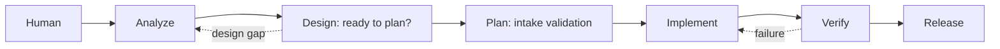

# Agentic SDLC Usage Guide

The toolbox uses lifecycle-stage agents. Requirements and design are human-gated; planning performs
an independent intake check before everything downstream is prepared for delegated execution by an
external Codex/Claude-compatible harness.



## Start with a request

```text
The system must allow users to sign in without creating a password.
```

`analyze` inspects existing product context, interviews the human when needed, and creates or
updates the PRD. `design` resolves architecture and Event Model changes, performs a design handoff
review, and asks whether the candidate work is ready to plan. Both stop for approval.

## Plan an Event Modeled change

```text
Use the plan stage for the approved Event Model changes in this worktree.
Inspect the changed model and slices, validate them with em, and produce the Markdown and JSON
work graph. Do not create branches or PRs.
```

The plan stage first validates the incoming design handoff. For Event Modeled work it then invokes
`slices-to-backlog`, which discovers changed `.em` files, slice documents, and `.event-modeling.md`
state from the current worktree. It does not require a model-file argument. If intake fails, the
planner returns blockers to design instead of creating a speculative plan.

## Plan a conventional change

```text
Use the plan stage for the approved PRD and ADRs.
Produce the conventional specification, plan, tasks, dependencies, and verification work.
```

## Delegate execution

The plan stage emits one bounded work item per implementation unit. An external harness may then
launch `implement` workers in parallel, run `verify` workers after dependencies complete, and hand
the verified graph to `release`.

Each worker receives a context packet containing:

- objective and lifecycle stage;
- approved source artifacts;
- allowed files and expected outputs;
- dependencies and branch/PR context;
- required validation commands;
- stop conditions and escalation targets.

The toolbox does not provide the scheduler, worktree manager, or auto-merge engine. Use an existing
harness appropriate to the environment; the JSON work graph is the integration boundary.

## Install and refresh

```bash
./install.sh --surface codex
# or
./install.sh --surface claude

dev-toolbox update
```

See [design.md](design.md) for the role contracts, artifact ownership, and work-graph schema.
